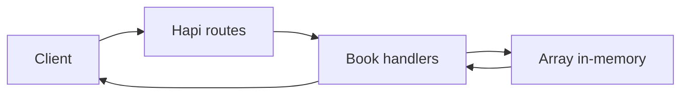

# Bookshelf API

Bookshelf API adalah REST API sederhana untuk menambah, melihat, memperbarui, menghapus, dan memfilter daftar buku. API dibuat menggunakan Hapi.js.

## Alur request



Data disimpan dalam array selama server berjalan. Data akan hilang saat proses server dimulai ulang.

## Menjalankan

Pastikan Node.js dan npm tersedia, lalu dari root repository:

```bash
npm install
npm start
```

Server berjalan di `http://localhost:9000`. Script lint tersedia melalui `npm run lint`.

## Endpoint

| Method | Path | Kegunaan |
| --- | --- | --- |
| `POST` | `/books` | Menambahkan buku |
| `GET` | `/books` | Melihat daftar buku |
| `GET` | `/books/{bookId}` | Melihat detail buku |
| `PUT` | `/books/{bookId}` | Memperbarui buku |
| `DELETE` | `/books/{bookId}` | Menghapus buku |

`GET /books` mendukung filter `name`, `reading`, dan `finished`. Untuk dua filter boolean, gunakan `0` atau `1`.

Contoh menambahkan buku:

```json
{
  "name": "Contoh Buku",
  "year": 2024,
  "author": "Nama Penulis",
  "summary": "Ringkasan singkat",
  "publisher": "Penerbit",
  "pageCount": 200,
  "readPage": 25,
  "reading": true
}
```

API memeriksa nama buku dan memastikan `readPage` tidak melebihi `pageCount`. Penyimpanan masih in-memory, sehingga proyek ini belum memakai database persisten.
